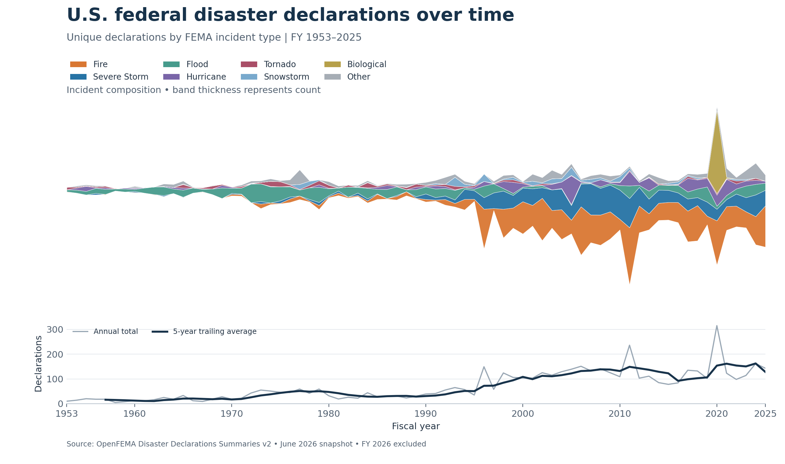

# FEMA Disaster Trend Analysis

## Overview

An exploratory data analysis and visualization project examining historical federally declared disasters across the United States using publicly available FEMA data.

The project investigates long-term trends in disaster declarations and how the distribution of disaster types has changed since 1953.

## Research Objectives

- Examine changes in disaster declarations over time.
- Identify the most frequently recorded disaster types.
- Explore historical trends across different incident categories.
- Develop accessible visualizations for nontechnical audiences.
- Communicate findings relevant to emergency preparedness and public awareness.

## Technologies Used

- **Language:** Python
- **Data Manipulation:** pandas
- **Data Visualization:** Matplotlib
- **Development Environment:** Google Colab
- **Data Format:** CSV

## Dataset

**Source:** Federal Emergency Management Agency (FEMA)

**Dataset:** Disaster Declarations Summaries — v2

- Approximately 70,000+ records
- 28 variables
- Historical records beginning in 1953
- Includes geographic information, incident types, declaration dates, and recovery programs

[Access the OpenFEMA Dataset](https://www.fema.gov/openfema-data-page/disaster-declarations-summaries-v2)

## Methodology

1. Import and explore the FEMA dataset using pandas.
2. Identify the seven most frequently recorded incident types.
3. Consolidate less frequent categories into an "Other" group.
4. Aggregate records by fiscal year and incident type.
5. Develop a streamgraph using Matplotlib.
6. Evaluate visualization effectiveness and communicate findings.

## Key Findings

- Recorded disaster declaration activity increased over the historical period.
- Severe storms were a prominent contributor to recorded declaration activity.
- Hurricane-related records showed a notable spike around 2005.
- Biological disaster records showed a substantial spike in 2020.
- The distribution of incident types varied considerably over time.

## Visualization

The streamgraph illustrates changes in the volume and composition of FEMA disaster declaration records over time.

## Limitations

- FEMA disaster declaration records do not necessarily represent unique disaster events.
- Changes in federal declaration policies may influence historical trends.
- National-level aggregation does not capture regional differences.
- Streamgraphs are less effective for precise numerical comparisons.
- Increases in declarations do not independently establish increases in natural disaster frequency.

## Future Improvements

- Add state-level filtering and geographic visualizations.
- Compare unique disaster declarations rather than individual dataset records.
- Calculate growth rates by incident type.
- Develop an interactive visualization dashboard.
- Investigate regional differences in disaster declaration trends.

## Project Background

Originally developed as a CIS 320 final project at Grand Valley State University in June 2026.
